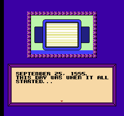

# Time Twist - Translation Project

This GitHub project contains all the tools you need to get started on your translation project of Time Twist.

Unlike other translation attempts and tools for the game, AI was *not* used to create the tools inside of this project.

## Compilation Instructions
The tools are coded in C#. You'll have to mess with Wine or mono if you want them to run in Linux. You'll also have to rewrite the bat files.

Include the game's two disk image files in the roms folder:
* `Time Twist - Rekishi no Katasumi de... - Zenpen (Japan).fds`
  * First disk (you boot from this)
* `Time Twist - Rekishi no Katasumi de... - Kouhen (Japan).fds`
  * Second disk (will return an error screen if you attempt to boot from this)

The bat files:
* If you want to dump the script for whatever reason, you can dump it by executing the bat file `Dump.bat` by double clicking it.
* To generate an FDS file with the translation, execute the bat file `Write.bat` by double clicking it.

If the disk utility returns an error, you probably have a bad dump with junk data on the disk. For the second disk, data after `0xC69B` and `0x1C5CF` should be zero. Data after these addresses are junk that should be blanked.

### Manual

Check out the repo [time-twist-fds-en-manual](https://github.com/romh-acking/time-twist-fds-en-manual) for manual resources. It contains two versions of the manual: one with all the Japanese text blanked out and one that is typesetted. Much thanks to Dustin Hubbard from Gaming Alexandria for providing the scans of the manual. Check out the original scans here:

[https://www.gamingalexandria.com/wp/2019/02/time-twist-rekishi-no-katasumi-de-zenpen](https://www.gamingalexandria.com/wp/2019/02/time-twist-rekishi-no-katasumi-de-zenpen)

While there's a manual which came with the game and the disk fax pamphlet, I only did the manual. The pamphlet practically has the same content as the manual.

## Tools
* `fdsBuilder/FDSBuilderC-Sharp.exe`
  * Used to extract and insert files into the fds disk image file
* `script/dump.py`
  * Converts the decompresses the game's script files
  * Arguments:
    * `input`
      * Input disk image file
    * `output`
      * Output `.txt` file
    * `textPointer`
      * The compressed script files have 25 pointers at the top. The ids passed here indicate which pointers are text pointers
    * `externalPointerMetadata`
      * The location of the externalPointerMetadata file.
      * This keeps the pointers in sync across the many script files, as they cross reference each other.
    * `fileOutOfBounds`
      * In the game, a main file will be written. Afterwards, subsequent (smaller) files will be written on top of it, while also referencing data and code from the non-overwritten parts. To accommodate this scenario, this argument indicates what file is to be read when reading outside of the current file's boundaries. 
    * `embeddedTextPointer`
      * The game has multiple bitstreams of text information. These are broken up to save time because every time a line is read, the bitstreams are iterated over. This argument indicates which pointer ids (at the top of the file) are text pointer tables.
    * `dictionary`
      * Indicates pointer id at the top of the file points to the dictionary.

* `script/line.py`
  * A tool that formats lines and inserts linebreaks and scroll control codes for you.
* `script/write.py`
    * `input`
      * Input `.txt` file
    * `output`
      * Output disk image file
    * `externalPointerMetadata`
      * The location of the externalPointerMetadata file.
      * This keeps the pointers in sync across the many script files, as they cross reference each other.
    * `dryRun`
      * When set to `true`, an output file will not be created.
      * A dry run is used for building up the `externalPointerMetadata` file.
    * `fixedData`
      * Defines which labels are fixed to what location.
      * Assembly code is stored in certain script files and cannot be moved without disassembling the code.
    * `isTranslation`
      * This flag indicates the script file is in the translation's encoding.

## Etc
The folder `zzz_extras` contains table files for a debug emulator's RAM viewer. This allows you to see text in the game's text buffer at `0x8747`. Simply load the table files in the memory viewer and jump to the address.

## Changelog
* 2026 October 27th: 1.0
    * Initial release

## Credits

### Main Team
* FCC
    * Initial ASM work
    * Utilities
    * Proofreader
    * Manual
* sudgy
    * [Initial translation](https://github.com/sudgy/nintendo_translations)
* Her-saki
    * Manual translation

### Support
* Bunkai
    * Spot translation

### Beta Testers
* ppltoast
* Missile
* Bro3256
    * Real hardware tester
